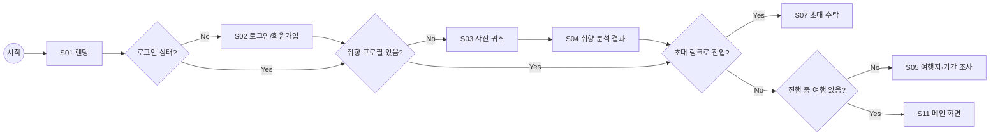
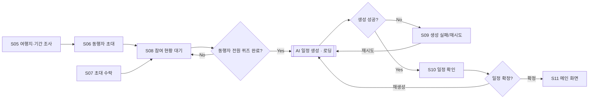
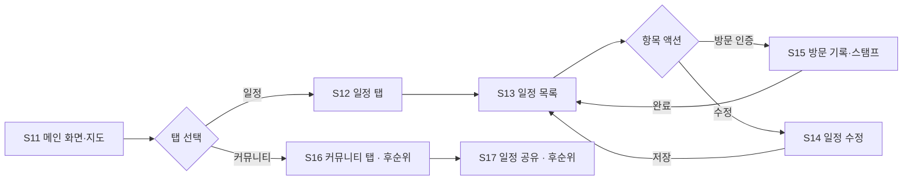

# 사용자 플로우 & 화면 목록

## 범례
- **Screen**: 디자인할 화면 (S01~S15)
- **Optional**: 후순위 화면 (S16, S17)
- **Decision**: 분기 조건
- **System**: AI·서버 처리

## 화면 목록

| ID | 화면 | 구역 | 우선순위 |
|---|---|---|---|
| S01 | 서비스 접속 (랜딩) | 온보딩 | MVP |
| S02 | 로그인 / 회원가입 | 온보딩 | MVP |
| S03 | 사진 퀴즈 | 온보딩 | MVP |
| S04 | 취향 분석 결과 | 온보딩 | MVP |
| S05 | 여행지·기간 조사 | 여행 생성 | MVP |
| S06 | 동행자 초대 (초대 ID·링크) | 여행 생성 | MVP |
| S07 | 초대 수락 (동행자) | 여행 생성 | MVP |
| S08 | 참여 현황 대기 | 여행 생성 | MVP |
| S09 | 생성 실패 / 재시도 | 여행 생성 | MVP |
| S10 | 일정 확인 (공통·분리·번갈아) | 여행 생성 | MVP |
| S11 | 메인 화면 (지도) | 메인 | MVP |
| S12 | 일정 탭 | 메인 | MVP |
| S13 | 일정 목록 | 메인 | MVP |
| S14 | 일정 수정 | 메인 | MVP |
| S15 | 방문 기록 (스탬프) | 메인 | MVP |
| S16 | 커뮤니티 탭 | 메인 | 후순위 |
| S17 | 일정 공유 | 메인 | 후순위 |

## 1. 온보딩

- 초대 링크로 들어온 동행자도 **로그인과 취향 프로필 확인을 먼저 거친** 뒤 S07로 간다.

## 2. 여행 생성

- AI 일정 생성은 **동행자 전원이 취향 퀴즈를 마친 뒤에만** 시작한다.
- S10에서 사용자는 일정을 확정하거나 재생성을 요청할 수 있다.

## 3. 메인

